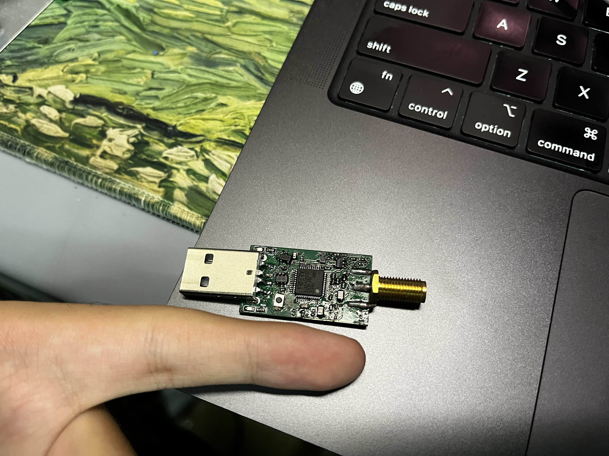
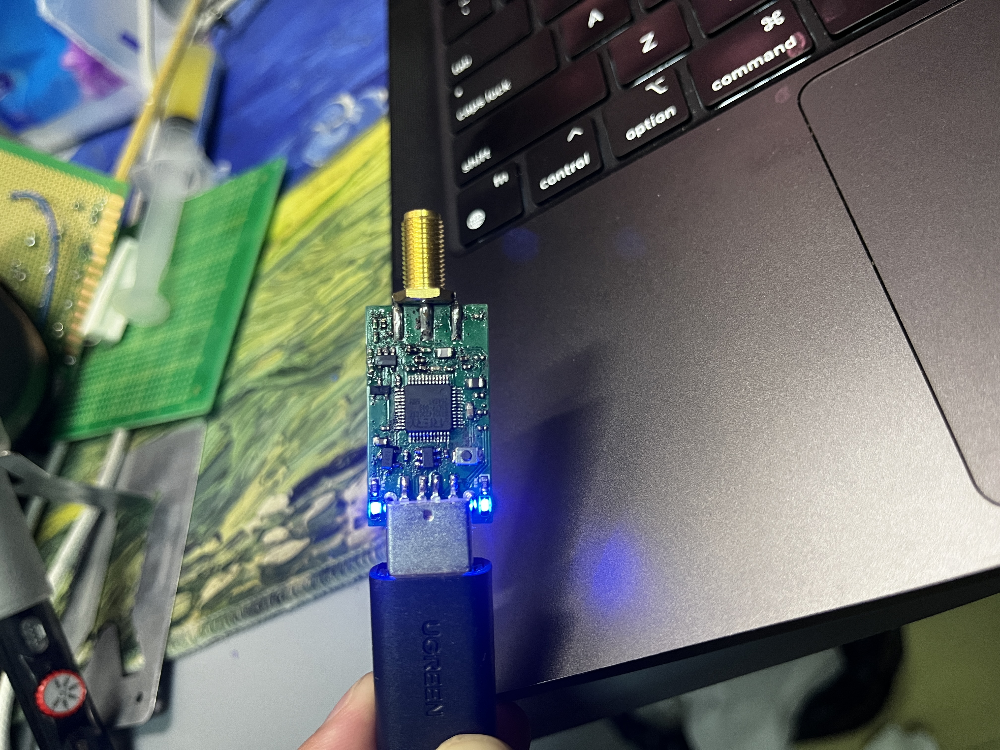
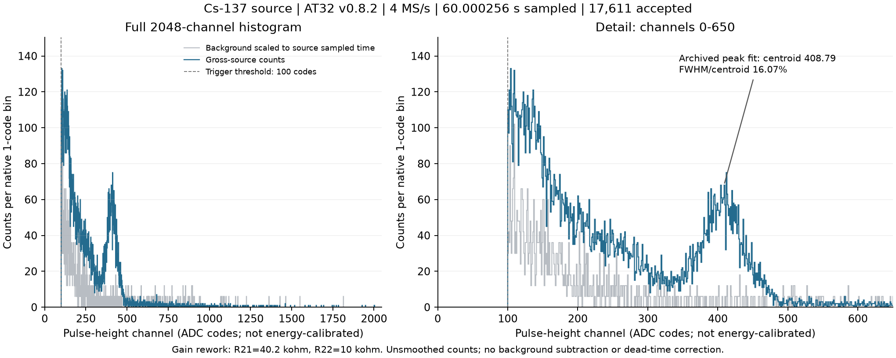
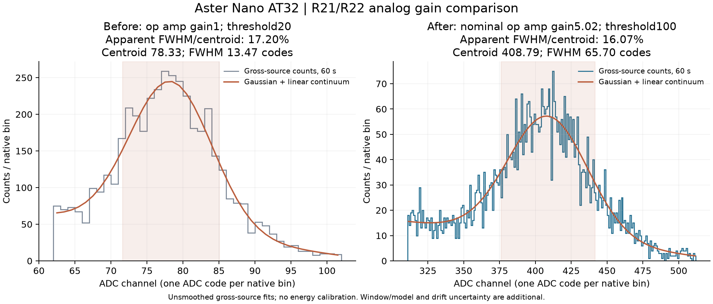

# Aster MCA Nano

中文 | [English](README.en.md)

低成本、**32 × 18 mm** 的 USB 多道脉冲幅度分析器原型。接收探测器已有放大／整形电路的低压输出，板上完成 ADC 采样和脉冲幅度直方图累计，电脑负责显示和保存。

本项目分为 **AT32 与 CH32 两条开发主线**，与 FPGA 版 [Aster MCA](https://github.com/pulsefoundry/Aster-MCA) 是独立项目。

| 主线 | 状态 | 资料入口 | Git 分支 |
|---|---|---|---|
| **AT32F423 + TLV9061** | 当前采谱主线；4 MS/s、2048 道，已保存铯源实测 | [AT32 指南](docs/at32/README.md) | [codex/at32](https://github.com/pulsefoundry/Aster-MCA-Nano/tree/codex/at32) |
| **CH32X033F8P6** | **仍在处理基线漂移与异常尖峰问题**；目前为模拟链诊断阶段，尚未完成可靠采谱验证 | [CH32 状态与硬件](docs/ch32/README.md) | [codex/ch32](https://github.com/pulsefoundry/Aster-MCA-Nano/tree/codex/ch32) |

`main` 保存总览、共享上位机和实验档案；两条器件分支分别提供开发入口，固件位于各自的 `firmware` 子目录。文档整理于 2026-10-21，最近一次上板实验为 2026-10-18。

## AT32 实物

  
  

实装为 AT32F423CCT7、TLV9061，USB-A 公头、SMA 母座，PCB 厚 1.6 mm，两颗蓝色 LED 分别指示通电和运行。照片为手焊原型；公开副本移除了位置等元数据，保留原始像素与显示方向。

## AT32 当前配置与固件

| 项目 | 配置 |
|---|---|
| PCB | v0.3，32 × 18 mm；原工程 MCU 为 CBT7，当前实物为 CCT7 |
| 模拟前端 | TLV9061；R21 = 40.2 kΩ、R22 = 10 kΩ，运放标称增益 5.02 |
| 固件 | **v0.8.2**，[源码](firmware/at32-peak-scope) · [已验证 BIN](outputs/Aster-MCA-Nano-AT32-波形诊断-v0.8.2-20261018/aster-at32-peak-v0.8.2.bin) |
| 正常采谱 | 4 MS/s、12 位 ADC，负脉冲取峰，板上累计 2048 道；到设定时间停止后一次回传 |
| 改焊板触发门限 | **100 ADC 码**；原增益配置为 20 码 |
| RAW 诊断 | 空闲时抓取 4096 点／1.024 ms，停止后上传；段间有空隙 |
| 上位机 | [macOS 原生桌面软件源码](firmware/at32-continuous/desktop)，v0.6.1；保留浏览器开发入口 |

上位机目前在重连后会回填门限 20，使用改焊板需手动确认 **100**。[构建、使用和离线复核](docs/development.md)说明 SDK、工具链和软件检查；[AT32 指南](docs/at32/README.md)说明固件适用配置及烧录工具限制。

## 已保存的铯源谱

蓝线为未平滑总源谱，灰线为按采样时长缩放的本底，未作相减；左图覆盖全部 2048 道，右图放大 0–650 道。下面保留原增益改焊前后的峰拟合对照。

| 60 秒总源谱 | 原增益配置 | 改焊后配置 |
|---|---:|---:|
| 固件 | v0.8.0 | v0.8.2，整数取峰算法相同 |
| 运放标称增益／门限 | 1／20 码 | 5.02／100 码 |
| 接受事件 | 15,896 | 17,611 |
| 峰位／ADC 码 | 78.33 | 408.79 |
| FWHM／峰位 | 17.20% | **16.07%** |

横轴仍为道数／ADC 码，未做多点能量标定。图中为未平滑总源谱的高斯峰加线性连续本底拟合，没有先扣本底。改焊后拟合窗口敏感性约 15.36%–16.96%；前后差值的模型条件下 95% 区间为 −2.50 至 +0.33 个百分点，尚不能确认分辨率改善，也不能据此认定探头本征分辨率。

最新 60.000256 s 采集的 58,594 个 DMA 块全部完成，记录中无设备错误或 ADC 溢出。这是该次采集的结果，尚未建立全计数率范围的性能指标。

- [最新 2048 道源谱 CSV](outputs/Aster-MCA-Nano-AT32-增益5倍实测-20261018/Cs-source-60s-2048ch.csv) · [元数据](outputs/Aster-MCA-Nano-AT32-增益5倍实测-20261018/Cs-source-60s-2048ch-metadata.json)
- [原始谱、短波形、本底与拟合记录](outputs/Aster-MCA-Nano-AT32-增益5倍实测-20261018) · [实验检查点](docs/2026-10-18-checkpoint.md)
- [早期 v0.6.3 十分钟铯源谱](outputs/Aster-MCA-Nano-AT32-v0.6.3-铯源10分钟分辨率-20261016/铯源谱与分辨率拟合.png)：积分算法和配置不同，仅作历史记录。

## AT32 单板成本

**已知价格部分约 ¥17.86／板，另加外购 USB-A、SMA 和两颗库存 LED 的实际成本。**

| 项目 | 单板金额 |
|---|---:|
| PCB，按项目给定成本 | ¥4.00 |
| AT32，按项目给定成本 | ¥5.00 |
| 其余已报价元件，按当前改焊用量 | ¥8.855465 |
| **已知价格合计** | **¥17.855465，约 ¥17.86** |
| USB-A、SMA、LED1/LED2 | 缺少实际价格，未计入 |

阻容和其他芯片沿用 2026-10-10 BOM 报价的单价，逐项乘以单板实装数量。不是五套采购额的平均值，也不含起订余料、运费、焊接人工、外壳或探头。详见[逐项成本、料号与计算口径](docs/at32/cost.md)和[价格输入](docs/at32/cost-inputs.json)。

## 原理图、Gerber 和装配

| 下载 | AT32 v0.3 | CH32 v0.3 |
|---|---|---|
| 原理图 PDF | [AT32 原理图](outputs/Aster-MCA-Nano-AT32-v0.3-USB-A-LED/Aster-MCA-Nano-AT32-v0.3-USB-A-LED-Schematic.pdf) | [CH32 原理图](outputs/Aster-MCA-Nano-CH32-v0.3-USB-A-LED/Aster-MCA-Nano-CH32-v0.3-USB-A-LED-Schematic.pdf) |
| Gerber ZIP | [AT32 Gerber](outputs/Aster-MCA-Nano-AT32-v0.3-USB-A-LED/Aster-MCA-Nano-AT32-v0.3-USB-A-LED-Gerber.zip) | [CH32 Gerber](outputs/Aster-MCA-Nano-CH32-v0.3-USB-A-LED/Aster-MCA-Nano-CH32-v0.3-USB-A-LED-Gerber.zip) |
| 立创 EDA 工程、BOM、PCB 图 | [AT32 硬件包](outputs/Aster-MCA-Nano-AT32-v0.3-USB-A-LED) | [CH32 硬件包](outputs/Aster-MCA-Nano-CH32-v0.3-USB-A-LED) |
| 手焊位号与料号对照 | [AT32 装配](outputs/Aster-MCA-Nano-AT32-v0.3-焊接对照) | [CH32 装配](outputs/Aster-MCA-Nano-CH32-v0.3-焊接对照) |

原 v0.3 文件保留发布状态：AT32 R21 = 0 Ω、R22 不装。复现当前实测须按[增益改焊说明](outputs/Aster-MCA-Nano-AT32-增益改焊-20261018)覆盖这两项。CH32 移除 C9 是诊断改动，不适用于 AT32。接头替代件需核对焊盘和实际板厚，照片中的外购件不代表原 BOM 连接器型号。

历史[双设计开槽合板工程](outputs/Aster-MCA-Nano-v0.3.1-SlotCut-Bridge2p5-32x38)曾被厂方拒单，保留为工程档案；制造入口为上表的两份独立单板 Gerber。

## 开发与归档

[开发指南 / Development guide](docs/development.md)包含固件构建、原生软件打包、离线拟合及档案校验。`work/` 中的第三方 SDK、工具链、虚拟环境和临时数据不纳入 Git。v0.7.x 是未通过真实脉冲持续处理的历史实验，v0.8.1 RAW 已判失败；两者均不作为当前采谱版本。

项目自身尚未指定开源许可证。仓库公开不改变第三方授权条款；CH32 中保留的 WCH 代码沿用原版权声明和仅用于 WCH 微控制器的限制，见 [SOURCE-NOTES](firmware/ch32-selftest-v0.3/SOURCE-NOTES.txt)。
