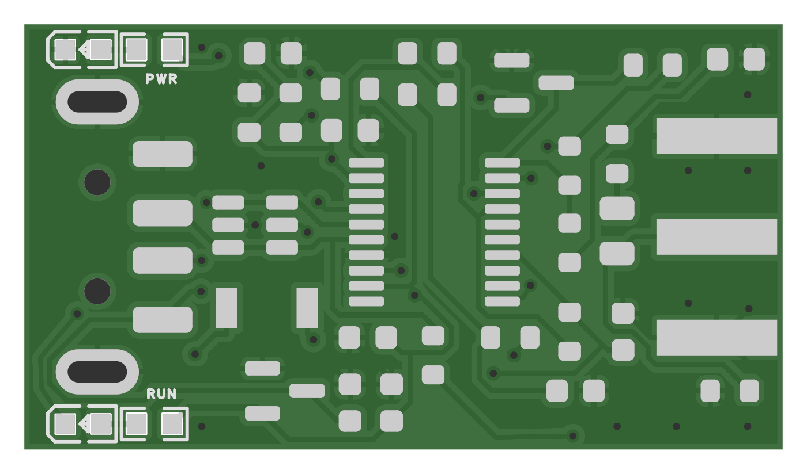

# Aster MCA Nano — CH32

> **仓库已迁移 / Repository moved**
>
> 后续开发与完整资料位于 **[Aster-MCA/nano](https://github.com/pulsefoundry/Aster-MCA/tree/main/nano)**。
> [AT32 主线](https://github.com/pulsefoundry/Aster-MCA/tree/main/nano/docs/at32) · [CH32 主线](https://github.com/pulsefoundry/Aster-MCA/tree/main/nano/docs/ch32) · [English](https://github.com/pulsefoundry/Aster-MCA/tree/main/nano/README.en.md)
>
> 本仓库保留历史文件、分支和旧下载链接。Nano 项目原创内容采用 [MIT](LICENSE)，第三方条款见[说明](THIRD_PARTY_NOTICES.md)。

中文 | [English](README.en.md) | [项目总览](https://github.com/pulsefoundry/Aster-MCA-Nano/tree/main)

**CH32X033F8P6 仍在处理基线漂移和异常尖峰问题。当前是模拟链与 ADC 诊断分支，尚未完成可靠采谱验证。**

**Baseline drift and abnormal spikes remain under investigation. This is an analog-chain and ADC diagnostic track; reliable spectroscopy has not been validated.** Successful USB communication or a waveform checksum does not establish pulse-height accuracy or energy resolution.

## 硬件 / Hardware

32 × 18 mm PCB，CH32X033F8P6、片上运放、USB-A 和 SMA 接口；实装板厚 1.6 mm，两颗蓝色 LED 指示通电与运行。

- [原理图 / Schematic PDF](outputs/Aster-MCA-Nano-CH32-v0.3-USB-A-LED/Aster-MCA-Nano-CH32-v0.3-USB-A-LED-Schematic.pdf)
- [单板 Gerber / Single-board Gerber ZIP](outputs/Aster-MCA-Nano-CH32-v0.3-USB-A-LED/Aster-MCA-Nano-CH32-v0.3-USB-A-LED-Gerber.zip)
- [立创 EDA 工程 / EasyEDA project](outputs/Aster-MCA-Nano-CH32-v0.3-USB-A-LED/Aster-MCA-Nano-CH32-v0.3-USB-A-LED-EDA-VERIFIED.epro2)
- [BOM 与 PCB 图 / BOM and board views](outputs/Aster-MCA-Nano-CH32-v0.3-USB-A-LED)
- [手焊对照 / Hand-assembly reference](outputs/Aster-MCA-Nano-CH32-v0.3-焊接对照)

## 诊断固件 / Diagnostic firmware

[固件源码](firmware/ch32-selftest-v0.3) · [模式与协议说明](firmware/ch32-selftest-v0.3/README-波形诊断.txt) · [主机读取工具](firmware/ch32-selftest-v0.3/host/capture_wave.py)

v0.3 支持三通道慢读、AD 单通道、暂停 ADC、4096 点 DMA 波形块及幅度范围触发块。波形模式标称约 333 kS/s，上传时暂停采样，块间有死时间。它不是 AT32 的 4 MS/s 取峰固件。

The v0.3 firmware supports slow multi-node measurements, AD-only readings, ADC pause, 4096-sample DMA waveform blocks and range-triggered diagnostic blocks. The nominal waveform sampling rate is approximately 333 kS/s. Sampling pauses during upload, so blocks have gaps. Triggered blocks are not event counts.

本轮历史诊断曾移除 C9，R15 仍为 100 Ω；原硬件包保留发布时 BOM，不能把这一改动当作已解决问题的设计修订。SMA 悬空、固定短接、探头开关和表笔接触状态会影响判断；目前没有确定根因，也没有 CH32 能谱分辨率指标。不要将 CH32 移除 C9 的诊断结果套用到 AT32。

Historical diagnostics used C9 removed and R15 = 100 Ω. The hardware archive preserves the original BOM. This was a diagnostic change, not a proven fix. The root cause remains unresolved, and no CH32 energy-resolution result is claimed. The AT32 hardware does not inherit this C9 change.

后续先复现稳定、可控的无信号基线，再验证有源脉冲幅度和采谱。当前可复核的源谱在 [AT32 主线](docs/at32/README.md)。

The next gate is a stable baseline under a controlled input condition, followed by pulse-height and spectrum validation. See the [AT32 track](docs/at32/README.en.md) for the archived source spectra.

## 第三方代码 / Third-party code

WCH 源码保留其版权及 WCH 微控制器使用限制，见 [SOURCE-NOTES](firmware/ch32-selftest-v0.3/SOURCE-NOTES.txt)。仓库公开不改变这些条款。

WCH source retains its original notices and restrictions to WCH microcontrollers. Public repository visibility does not change those terms.
