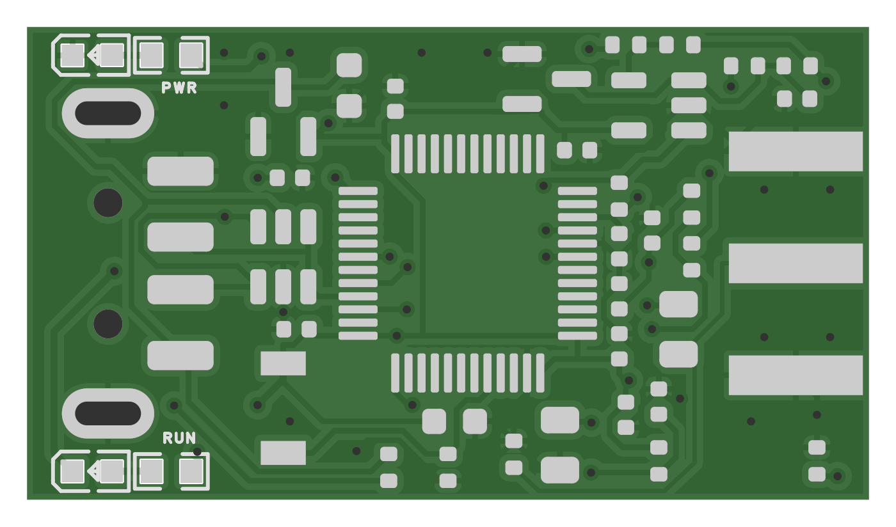

# AT32 development track

[中文](README.md) | English | [Project overview](../../README.en.md)

The current measured configuration is **AT32F423CCT7 + TLV9061, firmware v0.8.2, 4 MS/s and 2048 channels**. It accepts amplified/shaped low-voltage negative pulses. Normal acquisition continuously samples and accumulates a pulse-height histogram on the MCU, stops after the requested duration, then transfers the final spectrum.

## Hardware downloads



- [Schematic PDF](../../outputs/Aster-MCA-Nano-AT32-v0.3-USB-A-LED/Aster-MCA-Nano-AT32-v0.3-USB-A-LED-Schematic.pdf)
- [Single-board Gerber ZIP](../../outputs/Aster-MCA-Nano-AT32-v0.3-USB-A-LED/Aster-MCA-Nano-AT32-v0.3-USB-A-LED-Gerber.zip)
- [EasyEDA project](../../outputs/Aster-MCA-Nano-AT32-v0.3-USB-A-LED/Aster-MCA-Nano-AT32-v0.3-USB-A-LED-EDA-VERIFIED.epro2)
- [Grouped assembly reference and LCSC part numbers](../../outputs/Aster-MCA-Nano-AT32-v0.3-焊接对照/AT32-v0.3-合并取料与料号对照.csv)
- [R21/R22 rework instructions and placement](../../outputs/Aster-MCA-Nano-AT32-增益改焊-20261018)

The board measures 32 × 18 mm; the built PCB is 1.6 mm thick, with USB-A male and SMA female connections. The original v0.3 hardware files remain unchanged, with R21 = 0 Ω and R22 = DNP. **Current measurements use R21 = 40.2 kΩ and R22 = 10 kΩ, for a nominal U3 gain of 5.02.** The published cost uses this reworked population.

The original design lists AT32F423CBT7; the tested board uses CCT7 after a stock substitution. Connect the low-voltage signal output of an existing detector amplifier/shaper, never the detector HV port. Check substitute connectors against the footprint and actual PCB thickness.

## Firmware and desktop software

- **[v0.8.2 source](../../firmware/at32-peak-scope)** and **[validated v0.8.2 binary](../../outputs/Aster-MCA-Nano-AT32-波形诊断-v0.8.2-20261018/aster-at32-peak-v0.8.2.bin)**.
- [Protocol, stop timing and diagnostic limits](../../firmware/at32-peak-scope/README.txt).
- [v0.8.0 peak baseline](../../firmware/at32-peak) and [historical v0.6.3 integral-histogram baseline](../../firmware/at32-histogram).
- [Native macOS desktop app source and packager](../../firmware/at32-continuous/desktop).

The v0.8.2 binary is 24,004 bytes. SHA256:

```text
40bdc400d1342128eccd6fee780109b5912d556745b524498abc322755162dea
```

The measured firmware configuration uses a 144 MHz CPU clock, 72 MHz ADC clock and 1.3 V internal LDO. The ADC is 12-bit; the histogram has 2048 pulse-height bins, one ADC code per bin. The firmware/UI default threshold remains 20. **Set 100 for the gain-reworked board and check it again after reconnecting.**

`flash.py` is a guarded historical updater. Its default path accepts only the frozen v0.8.1 image before upgrading to v0.8.2; `--restore-peak` accepts only v0.8.2 before restoring v0.8.0. It backs up Flash/options and verifies readback. **It is not a generic blank-device installer.** Use a suitable official chip programming/DFU tool for initial programming with the supplied binary. Disconnect the SMA input, hold BOOT while connecting USB, then release. Do not bypass the updater's image checks. The v0.8.1 reference binary exists only for migration identity, not as a recommended firmware.

## Spectra and evidence


The latest post-rework run sampled 60.000256 s and accepted 17,611 events. The peak centroid was 408.79 ADC codes, with FWHM/centroid = 16.07%. There is no multipoint energy calibration. Fit-window sensitivity is approximately 15.36%–16.96%; the model-conditional 95% interval of the before/after width difference includes zero. These measurements establish the gain shift and the recorded acquisition's integrity, not a demonstrated resolution improvement or intrinsic detector limit.

- [Native spectrum, source/background records and finite raw waveforms](../../outputs/Aster-MCA-Nano-AT32-增益5倍实测-20261018).
- [Fit and sensitivity JSON](../../outputs/Aster-MCA-Nano-AT32-增益5倍实测-20261018/gain-peak-fit-comparison.json).
- [Original-gain v0.8.0 60-second spectrum](../../outputs/Aster-MCA-Nano-AT32-取峰-v0.8.0-20261018/cs-source-60s-fit.png).
- [Historical v0.6.3 10-minute spectrum](../../outputs/Aster-MCA-Nano-AT32-v0.6.3-铯源10分钟分辨率-20261016/铯源谱与分辨率拟合.png).
- [Detailed checkpoint](../2026-10-18-checkpoint.md).

Normal acquisition retains a final histogram, not per-event waveforms. RAW diagnostics capture 4096 samples per segment with upload gaps: 500 segments represent 0.512 s of sampled time. They must not be concatenated into a continuous trace. Historical v0.7.x streaming failed real-pulse processing, and v0.8.1 RAW was rejected after ADC overflow.

## Cost and reproduction

The current reworked population has a **priced subtotal of CNY 17.855465, approximately CNY 17.86 per board**: PCB 4.00, MCU 5.00, other quoted components 8.855465. Add actual USB-A, SMA and stock LED costs; their prices were not supplied. Shipping, labour, enclosure and detector electronics are excluded.

- [Bilingual itemized cost, part numbers and source rows](cost.md).
- [Reproducible price inputs](cost-inputs.json).
- [Firmware builds, desktop packaging, offline replay and archive checks](../development.md).
- [Prototype photographs](photos).
